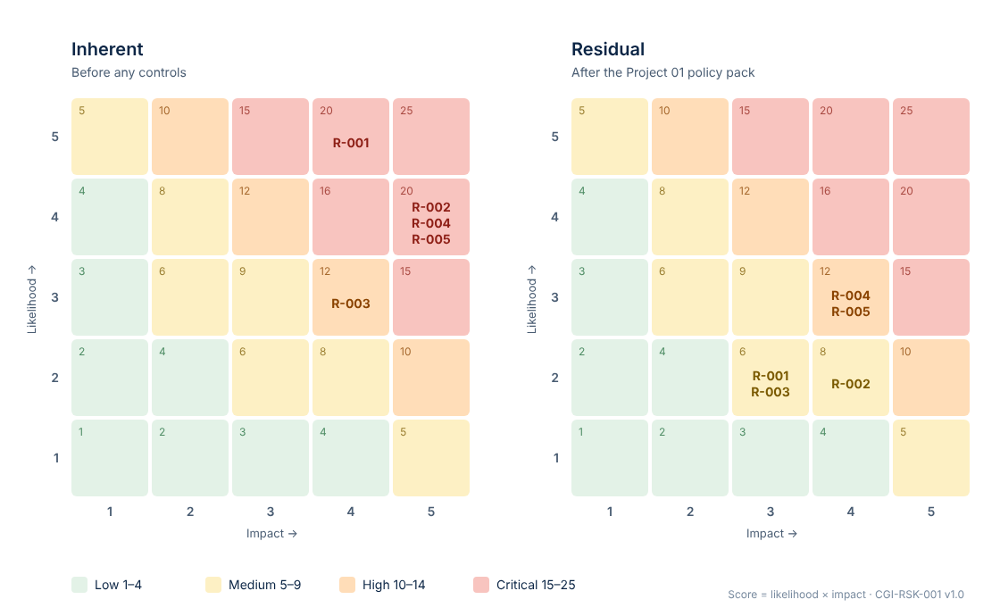

[← Portfolio home](../README.md) · [← 01 Policy Pack](../01-security-policy-pack/) · [Next: 03 CSF Gap Assessment →](../03-nist-csf-gap-assessment/)

# 02 · Master Information Security Risk Register

**Cypher Group Inc. · CGI-RSK-001 · Version 1.0 · Assessed 08 Sep 2026 · NIST SP 800-30 Rev. 1**

-2BAE66?style=flat-square)

> [!IMPORTANT]
> **Simulated case study.** Cypher Group Inc. is a simulated company; the method and the analysis are real. All scores, costs, names and approvals are invented to demonstrate risk identification, scoring, control mapping and treatment decisions.

## The question this answers

Project 01 wrote the rules. This project asks: **how much safer did those rules actually make the company — and where are we still exposed?**

Five realistic threat scenarios were scored twice — **inherent** (no controls) and **residual** (crediting only controls that exist and operate) — and every mitigating control is traced to a specific clause in the [Project 01 policy pack](../01-security-policy-pack/).

## What's in this folder

| Document | What it is | Read online | Download |
|---|---|---|---|
| **Master Risk Register** (CGI-RSK-001) | Scoring scales, the register, residual rationale, treatment plan, accepted and avoided risk, control gaps, KRIs, limitations | [View](02-master-risk-register.md) | [PDF](02-master-risk-register.pdf) · [Excel](02-master-risk-register.xlsx) |
| **Data sets** | Register, residual rationale, treatment plan, control gaps and KRIs as CSV | [Browse](data/) | CSV |

## The five risks

| ID | Scenario | Inherent | Residual | Treatment | Owner |
|---|---|:-:|:-:|---|---|
| R-001 | Phishing → account takeover via relayed one-time codes | 20 Critical | 6 Medium | Mitigate | IT Operations Manager |
| R-002 | Ransomware on an employee endpoint | 20 Critical | 8 Medium | Mitigate + Transfer | IT Operations Manager |
| R-003 | Departing employee exports customer data | 12 High | 6 Medium | Mitigate | Head of People and Operations |
| R-004 | Broken object-level authorisation in the production API | 20 Critical | **12 High** | Mitigate | Chief Technology Officer |
| R-005 | Public S3 bucket through CloudCo misconfiguration | 20 Critical | **12 High** | Mitigate | Chief Technology Officer |

Rating bands: Low 1–4 · Medium 5–9 · High 10–14 · Critical 15–25

## Heat maps

R-004 and R-005 only move one step on likelihood: the policy pack governs *who* may change code and cloud settings, not *how* software is tested or *how* cloud storage must be configured.

## The honest headline

> **The policy pack removes just over half of the assessed exposure at almost no direct cost. It does not touch two of the five scenarios — because it contains no rules on how software is built or how cloud infrastructure is configured.** Those two stay High, and they are where the next USD 32,100 should go.

| Metric | Value |
|---|---|
| Aggregate inherent → residual | 92 → 44 (**−52%**) |
| Residual High | 2 (R-004, R-005) — accepted by the CEO pending treatment |
| Treatment actions | 10 (TP-01 to TP-10), year-one cost **USD 32,100** |
| Control gaps | 5 (CG-01 to CG-05) |
| New policies recommended | Backup & Recovery · Secure Development · Vulnerability Management |
| Key risk indicators | 7 (KRI-01 to KRI-07) with green / amber / red thresholds |
| Later in the portfolio | [Project 04](../04-vendor-risk-management/) adds 9 supplier risks: v1.1 has 14 risks, a 43% reduction and 3 residual High |
| And then | [Project 07](../07-aws-cloud-compliance/) tests R-005's controls against the cloud configuration and withdraws the credits the evidence does not support: v1.2 re-scores R-005 from 12 to **20 (Critical)**, residual total 122 → 130 |
| Most recently | [Project 08](../08-ai-governance-eu-ai-act-iso42001/) adds two AI risks the register could not see: wrong AI output acted on (AR-001) and a tool used for a banned or high-risk purpose (AR-002). v1.3 has 16 risks, residual total 130 → 147 |

## All four treatment strategies, on the record

| Strategy | Where |
|---|---|
| **Mitigate** | All five risks — TP-01 to TP-10 |
| **Transfer** | Cyber insurance for ransomware (TP-04) — noting that reputational and regulatory liability cannot be transferred |
| **Accept** | ACC-001: SMS MFA for two finance users on a legacy portal, owned by the CTO, **expires 03 Mar 2027** |
| **Avoid** | AVD-001: Cypher never stores card numbers, so PCI DSS scope is avoided by design |

## Three things I would say in an interview

1. **"I score the control that is operating, not the control that is written."** Only 60% of staff had acknowledged the policies, so no residual score was credited at full policy strength.
2. **Backups are the seatbelt, not the brakes.** Patching and least privilege lower the *likelihood* of ransomware; tested backups are what lower the *impact* — and the pack has no backup policy, so R-002's impact only falls from 5 to 4.
3. **A 5 × 5 matrix ranks; it does not measure.** The register states its own limits: range compression, ordinal arithmetic, no incident history, and controls asserted rather than tested.

## Reuse this work

- [Risk register template](../templates/risk-register-template.docx) (Word) · [CSV](../templates/risk-register-template.csv) · [Markdown](../templates/risk-register-template.md)

---

[← 01 Policy Pack](../01-security-policy-pack/) · [Portfolio home](../README.md) · [Next: 03 CSF Gap Assessment →](../03-nist-csf-gap-assessment/)
